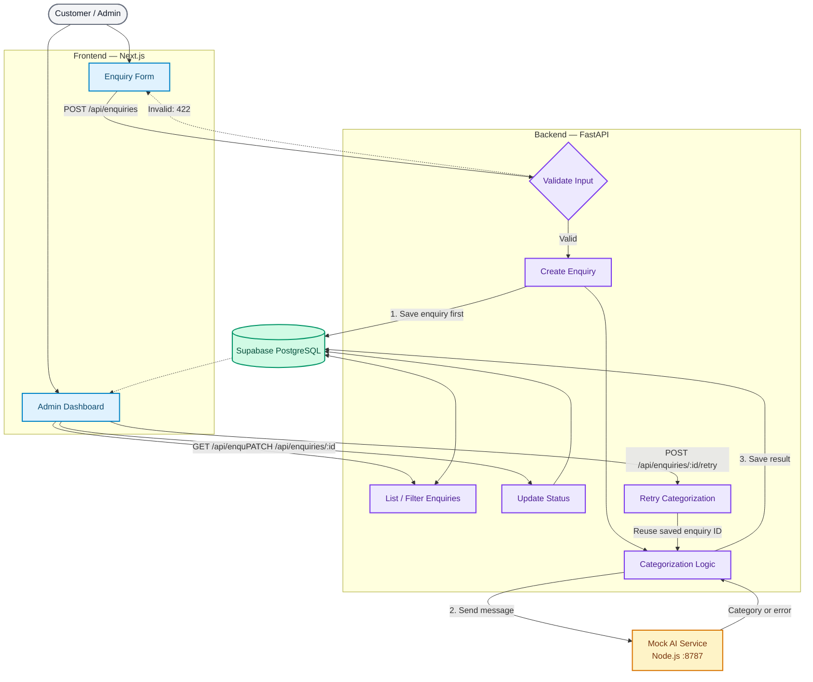

# Customer Enquiry Tracker

A small full-stack web application for collecting customer enquiries, saving them to a persistent database, automatically categorizing them using a supplied mock AI service, and tracking follow-up status.

## Features

- Public enquiry form with name, email, and message validation.
- FastAPI backend with server-side validation.
- Persistent PostgreSQL storage using Supabase.
- Automatic enquiry categorization using the supplied mock service.
- Allowed categories: `Sales`, `Support`, `Billing`, `Other`.
- Separate business status and categorization state.
- Dashboard with newest-first listing, status filtering, and status updates.
- Manual retry for failed categorization without creating duplicate enquiries.
- Loading, success, and error feedback.

## Technology Stack

- Frontend: Next.js, React, TypeScript, Tailwind CSS
- Backend: Python, FastAPI
- Python dependency management: `uv`
- Database: Supabase PostgreSQL
- Mock categorization service: Node.js

## Project Structure

```text
customer-enquiry-tracker/
├── backend/
│   ├── main.py
│   ├── .env.example  (template; keep real .env private)
│   ├── routes/
│   │   ├── enquiries.py
│   │   └── health.py
│   └── services/
│       └── categorization.py
├── frontend/
│   └── app/
│       ├── page.tsx
│       └── dashboard/
│           └── page.tsx
├── docs/
├── mock-ai-service.mjs
├── .env.example
├── README.md
└── .gitignore
```

## Prerequisites

- Node.js 18 or newer
- Python version compatible with the backend dependencies
- `uv`
- A Supabase PostgreSQL database

## Configuration

Copy the root `.env.example` template into `backend/.env`, then set your own database connection string. Keep `backend/.env` private and never commit it. The backend loads configuration from its environment file.

```env
DATABASE_URL=your_supabase_postgresql_connection_string
MOCK_AI_URL=http://127.0.0.1:8787/categorize
```

Replace the database placeholder with your own connection string. Never commit real credentials or secrets.

## Database Initialization

Create the `public.enquiries` table in your Supabase SQL Editor:

```sql
CREATE TABLE IF NOT EXISTS public.enquiries (
    id UUID PRIMARY KEY DEFAULT gen_random_uuid(),
    name TEXT NOT NULL,
    email TEXT NOT NULL,
    message TEXT NOT NULL,
    created_at TIMESTAMPTZ NOT NULL DEFAULT NOW(),
    status TEXT NOT NULL DEFAULT 'New'
        CHECK (status IN ('New', 'In Progress', 'Resolved')),
    category TEXT DEFAULT NULL
        CHECK (category IS NULL OR category IN ('Sales', 'Support', 'Billing', 'Other')),
    categorization_state TEXT NOT NULL DEFAULT 'Pending'
        CHECK (categorization_state IN ('Pending', 'Completed', 'Failed'))
);

CREATE INDEX IF NOT EXISTS idx_enquiries_created_at
    ON public.enquiries (created_at DESC);

CREATE INDEX IF NOT EXISTS idx_enquiries_status
    ON public.enquiries (status);
```

## Running the Application

Run each component in a separate terminal.

### 1. Start the mock service

From the project root:

```powershell
node mock-ai-service.mjs
```

Keep this terminal running.

Verify the service at `http://127.0.0.1:8787/health`. It should return a status of `ok`.

### 2. Start the backend

```powershell
cd backend
uv sync
uv run uvicorn main:app --reload
```

Backend URL: `http://127.0.0.1:8000`

Interactive API documentation: `http://127.0.0.1:8000/docs`

Database health check: `http://127.0.0.1:8000/health/database`

### 3. Start the frontend

In another terminal:

```powershell
cd frontend
npm install
npm run dev
```

Open `http://localhost:3000`.

Dashboard: `http://localhost:3000/dashboard`

For production build verification:

```powershell
npm run build
npm run start
```

## API Endpoints

| Method | Endpoint | Purpose |
|---|---|---|
| POST | `/api/enquiries` | Validate, save, and categorize an enquiry |
| GET | `/api/enquiries` | List enquiries newest first |
| GET | `/api/enquiries?status=New` | Filter enquiries by business status |
| PATCH | `/api/enquiries/{id}` | Update business status |
| POST | `/api/enquiries/{id}/retry` | Retry failed categorization |
| GET | `/health` | Backend health check |
| GET | `/health/database` | Database connectivity check |

### Example: Create an enquiry

Request:

```json
{
  "name": "Example Customer",
  "email": "customer@example.com",
  "message": "Please send pricing for your automation service."
}
```

Successful response: HTTP `201 Created`.

Example response shape (illustrative values; use the actual response from your running API if its field names differ):

```json
{
  "id": "saved-enquiry-uuid",
  "name": "Example Customer",
  "email": "customer@example.com",
  "message": "Please send pricing for your automation service.",
  "created_at": "2026-10-29T10:00:00Z",
  "status": "New",
  "category": "Sales",
  "categorization_state": "Completed"
}
```

The response includes the saved enquiry ID, creation timestamp, business status, category, and categorization state.

### Example: Update status

```json
{
  "status": "In Progress"
}
```

Send this JSON to `PATCH /api/enquiries/{id}` using the saved enquiry ID.

### Mock categorization request

The backend sends:

```json
{
  "enquiryId": "saved-database-id",
  "message": "Please send pricing for your automation service."
}
```

A successful mock response is:

```json
{
  "category": "Sales"
}
```

## Categorization and Retry Behavior

The application saves an enquiry before calling the mock service.

- A valid category is saved with categorization state `Completed`.
- A timeout, non-success HTTP response, malformed response, or invalid category results in state `Failed` and a null category.
- Failed enquiries remain stored.
- Manual retry uses the same saved enquiry ID and updates the existing record.
- Business status remains separate from categorization state.

The mock service simulates predictable outcomes for assessment. It is not a real AI model.

## Verification Notes

The following checks were run during local testing. The duplicate-count check is marked for final direct verification because a before/after database row count was not recorded:

| Check | Result |
|---|---|
| Valid enquiry saved and persists after refresh | Passed |
| Invalid email rejected in the browser | Passed |
| Blank required fields rejected in the browser | Passed |
| Invalid email rejected by backend with HTTP 422 | Passed |
| Valid category assigned and displayed | Passed |
| `[FAIL_ONCE]` enquiry retained in Failed state | Passed |
| Retry recovers categorization using the same saved enquiry ID | Passed |
| Database row count unchanged by retry | Needs direct verification |
| `[INVALID_ONCE]` response rejected and retry recovers | Passed |
| Business status persists after refresh | Passed |
| Status filter returns matching enquiries | Passed |
| Next.js production build completes successfully | Passed |

The invalid-email backend test returned HTTP 422. Database absence for that rejected request was not separately verified by a direct row-count check.

## Limitations and Trade-offs

- The supplied mock categorization service uses deterministic test rules, not a real AI model.
- Categorization is synchronous, with a bounded HTTP timeout.
- The dashboard is a local assessment demo without authentication.
- The mock stores attempt history in memory; restarting it resets test-attempt counters.
- Deployment, notifications, queues, and login are outside the assignment scope.

## Time Spent

Total time spent: 6-8 hours from 27-10-2026(2 hrs) night to 28-10-2026(4 hrs day and 2 at night).

Include implementation, testing, troubleshooting, and documentation. Do not enter a number unless it reflects your actual work. If relevant, separately note any time lost because the original assignment attachment was missing.

## AI Tool Disclosure

ChatGPT was used for implementation guidance, debugging assistance, frontend/backend integration support, and documentation. The application was run locally and the listed functionality was manually tested. Before submission, confirm that this accurately names the AI tools you used and describes your own contribution; edit it if needed.

## Submission Checklist

- [x] Source code and dependency manifests included
- [x] Lockfiles included where applicable
- [x] `.env.example` included without secrets
- [x] Database initialization documented
- [x] Architecture/process diagram included in this README
- [x] API request and response examples reviewed
- [x] Verification results reviewed; directly verify retry does not change the enquiry row count
- [x] Actual time spent recorded
- [x] AI-tool disclosure checked for accuracy
- [x] Repository checked for secrets before submission
## Architecture Diagram

The diagram below illustrates how the Next.js frontend, FastAPI backend, mock AI categorization service, and Supabase PostgreSQL database interact. Enquiries are saved before categorization, and retries reuse the existing enquiry ID.


